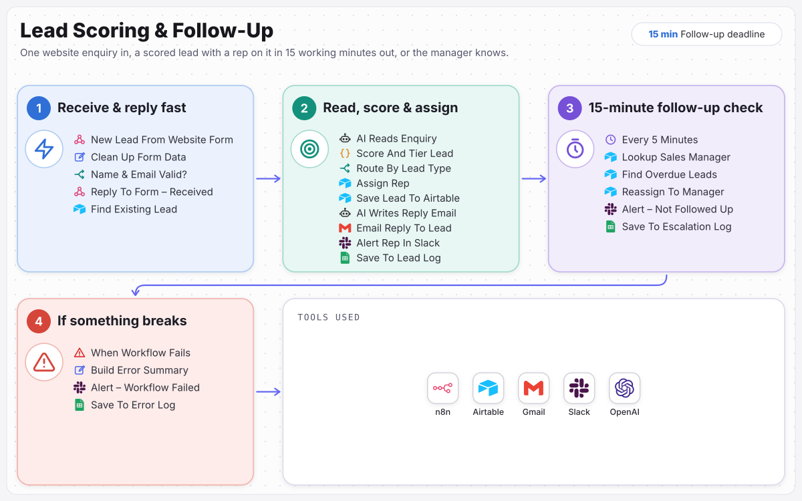

# Lead Scoring & Follow-Up

Every good lead has a rep on it within 15 working minutes, or the manager knows.

> Built for **Voltara Commercial Solar**, a fictional sample client. The business, people and data are invented; the workflow is complete and runs.

Website leads get a reply in under a second, then AI reads the enquiry, fixed rules score it, the right sales rep is assigned and alerted, and the lead gets a personal reply. If nobody follows up within 15 working minutes, the sales manager takes it.

**Full case study:** [ramonvallejera.com/case-study/solar-lead-scoring-follow-up](https://ramonvallejera.com/case-study/solar-lead-scoring-follow-up)

## How it works

1. Website form
2. Instant reply
3. Check for existing lead
4. AI reads the enquiry
5. Rule-based score
6. Assign rep
7. Personal reply
8. Slack alert
9. Manager steps in after 15 working minutes

Built an n8n workflow that replies to the website form in under a second, checks Airtable for existing customers and repeat enquiries, has AI read the message, scores the lead by fixed rules, assigns the next rep for that lead type, sends a personal reply and alerts the rep in Slack. A check every 5 minutes hands any lead not followed up within 15 working minutes to the sales manager. Leads that arrive overnight or at the weekend are due at 08:15 the next working morning.

## What's in this repo

| File | What it is |
|---|---|
| `workflow.json` | The n8n workflow, 48 nodes, ready to import |
| `docs/process-map.svg` | The process map from the case study |

Triggers: `New Lead From Website Form`, `Reply To Form - Received`, `Reply To Form - Missing Info`, `Every 5 Minutes`, `When Workflow Fails`.

## Set it up

1. In n8n, open **Workflows → Import from File** and choose `workflow.json`.
2. Create these credentials and select them on the nodes that need them:

   - Airtable (personal access token) (8 nodes)
   - Slack (OAuth2) (4 nodes)
   - Google Sheets (OAuth2) (4 nodes)
   - OpenAI (2 nodes)
   - Header auth (Apollo API key) (1 node)
   - Gmail (OAuth2) (1 node)

3. Replace the placeholders with your own records:

   - `YOUR_AIRTABLE_BASE_ID` (8×)
   - `YOUR_AIRTABLE_TABLE_ID` (8×): each node keeps the original table name as a hint
   - `YOUR_GOOGLE_SHEET_ID` (4×)
   - `YOUR_SLACK_CHANNEL_ID` (4×): the channel that receives alerts and approvals

4. Run it once with test data, then activate it.

Tools: n8n, Airtable, Gmail, Slack, OpenAI.

## Notes

- Credentials, webhook IDs, pinned test data and account-specific IDs were removed before publishing. n8n assigns new webhook URLs on import.
- Built by [Ramon Vallejera Jr.](https://ramonvallejera.com), AI Automation Engineer. Questions or a build like this for your team: [ramonvallejera.com/contact](https://ramonvallejera.com/contact).
